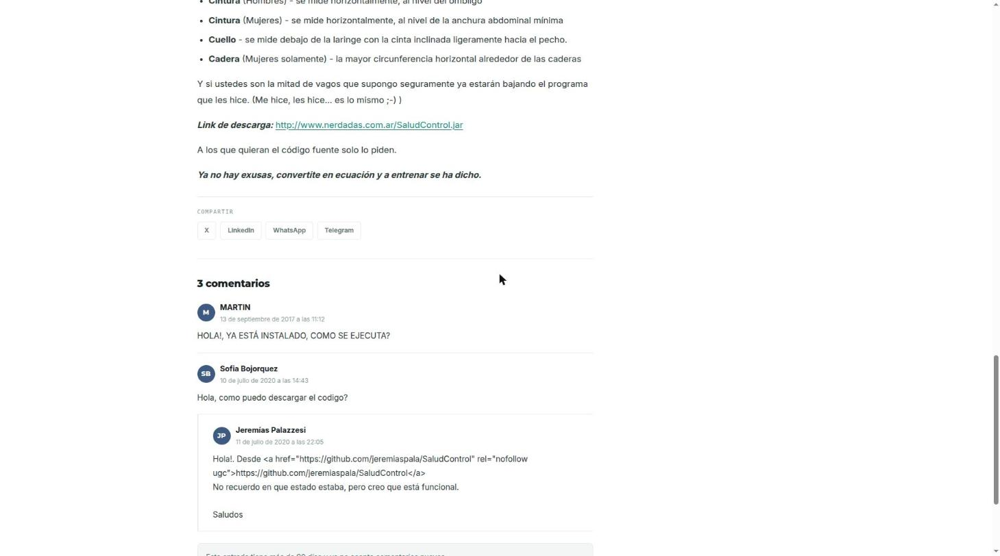
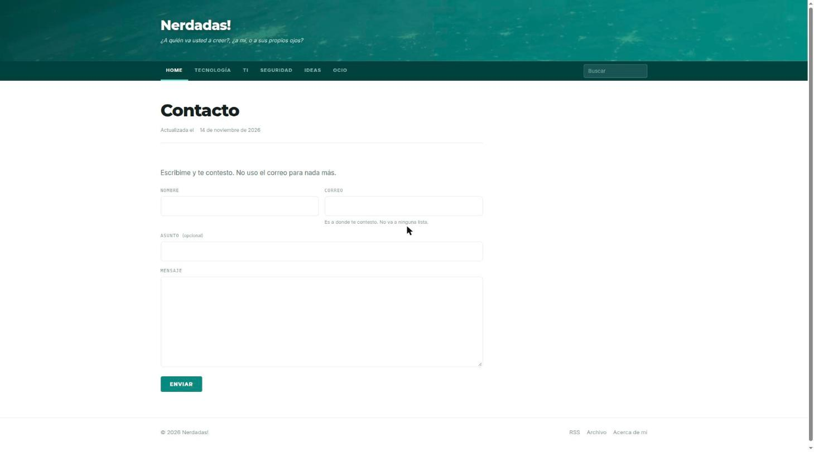
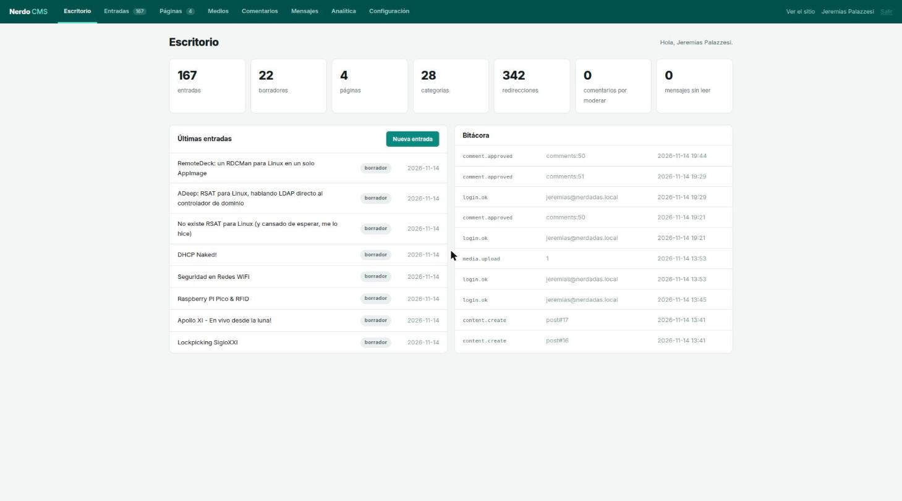
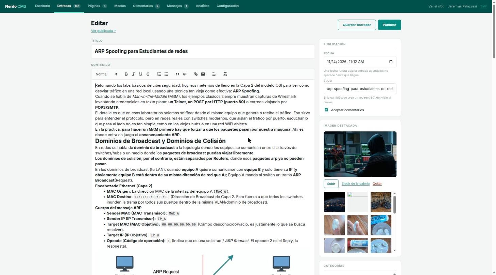
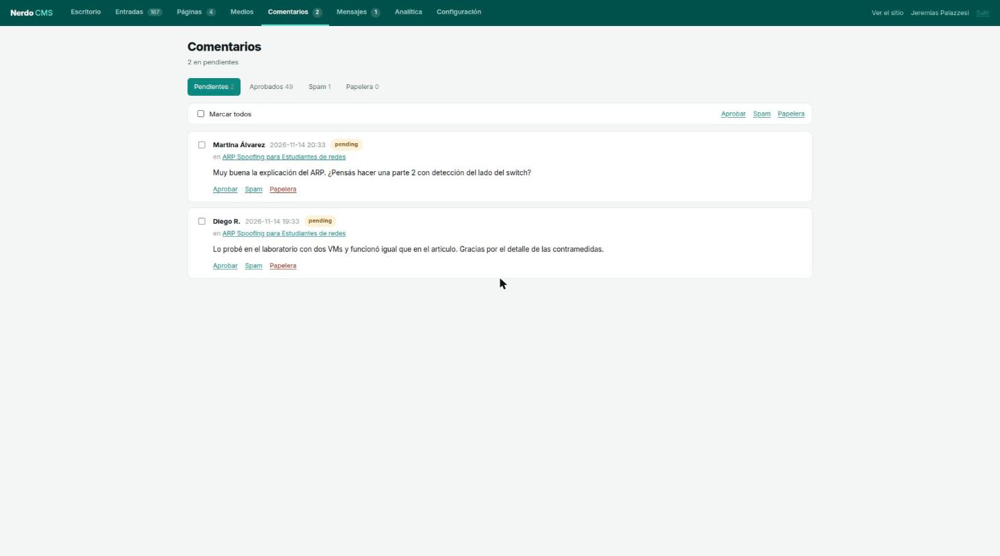
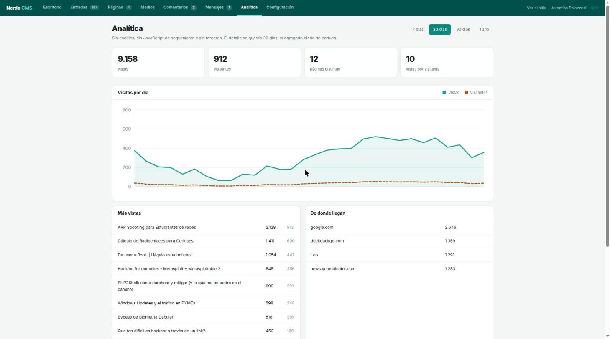

# Nerdo CMS

CMS en PHP, sin framework y con una sola dependencia de terceros, escrito para
reemplazar el WordPress de [nerdadas.com](https://www.nerdadas.com). Cada
decisión está tomada por reducción de superficie de ataque, no por cantidad de
funciones: un solo archivo PHP alcanzable desde internet, el panel en una ruta
configurable, CSP sin `unsafe-inline`, y ni un recurso de otro dominio en
ninguna página.

Lo que en WordPress eran siete plugins —reCAPTCHA, SEO, Analytics, caché,
ocultar el login, formulario de contacto— acá son seis archivos propios que se
pueden leer enteros.

| En WordPress era | Acá es |
|---|---|
| `advanced-google-recaptcha` | Prueba de trabajo en el navegador, sin Google |
| `autodescription` | `Services/Seo.php` + JSON-LD en las plantillas |
| `ga-google-analytics` | Analítica propia, sin cookies ni JavaScript |
| `wp-super-cache` | `Services/PageCache.php` |
| `wps-hide-login` | Ruta del panel configurable en `.env` |
| `contact-form-7` | Formulario propio con las mismas capas antispam |

## Capturas

| | |
|---|---|
|  |  |
| **Portada.** Tema Teal, tipografías autoalojadas. | **Entrada con hilos de comentarios.** Avatares de iniciales dibujados con CSS: sin Gravatar y sin pedirle nada a nadie. |
|  |  |
| **Contacto.** El formulario se dibuja dentro de la página que diga el ajuste. | **Escritorio.** Contadores, últimas entradas y bitácora de auditoría. |
|  |  |
| **Editor.** Quill, imagen destacada, SEO y fecha de publicación programada. | **Moderación.** Puntaje de spam con sus señales a la vista, acciones de a uno o en lote. |
|  | |
| **Analítica.** Sin cookies, sin JavaScript de seguimiento y sin banner de consentimiento. Los números de la captura son datos de ejemplo. | |

## Estado

| Fase | Qué incluye | Estado |
|------|-------------|--------|
| 1 | Kernel, Router, Db, Session, Csrf, Security, RateLimit, View, migraciones, tema Teal | hecho |
| 2a | Login con argon2id + bloqueo, panel, CRUD de entradas y páginas, editor Quill, saneador HTML, bitácora | hecho |
| 2b | Galería, subida con reprocesado, imagen destacada, srcset, og:image | hecho |
| 4 | Importador de WordPress: 145 entradas, 22 borradores, 4 páginas, 49 comentarios, 554 imágenes, 342 redirecciones | hecho |
| 5 | SEO: feed.xml, sitemap.xml, robots.txt, JSON-LD, redes | hecho |
| 7 | Analítica propia sin cookies, panel con gráfico | hecho |
| — | Configuración por secciones, correo mail()/SMTP, encabezado con foto, video embebido | hecho |
| 6 | Comentarios: hilos, antispam en ocho capas, cola de moderación | hecho |
| 3 | Caché de página completa, fuentes autoalojadas | hecho |
| — | Formulario de contacto: antispam propio, bandeja en el panel | hecho |
| 8 | Instalador, TOTP, endurecido final | pendiente |

## Requisitos

- PHP 8.3+ con `pdo_mysql`, `mbstring`, `intl`, `openssl`, `fileinfo`
- **`gd`** — para reprocesar las imágenes subidas (instalado: GD 2.3.3 con
  JPEG, PNG y WebP)
- MariaDB 10.6+ o MySQL 8
- Apache con `mod_rewrite` y `mod_headers`

## Desarrollo

```bash
php bin/console migrate        # aplica migraciones
php bin/console seed:demo      # contenido de prueba
php -S 127.0.0.1:8080 -t public bin/router.php
```

En la máquina de desarrollo el Apache local ya lo sirve en
`http://localhost:8080` con un vhost propio. Tiene que ser un vhost y no un
`Alias` dentro del sitio por defecto: el `DocumentRoot` apunta a `public/`, y
servirlo en un subdirectorio dejaría a `/panel`, `/uploads` y `/assets`
apuntando fuera de la aplicación.

Otros comandos: `migrate:status`, `user:create`, `gc`, `routes`,
`analytics:aggregate`, `analytics:summary`, `cache:clear`, `cache:stats`,
`cache:refresh`.

### Cron

```cron
# Agrega las visitas del día anterior y borra el detalle vencido.
17 3 * * *  cd /var/www/nerdadas && php bin/console analytics:aggregate

# Sesiones, límites de tasa y desafíos de comentarios ya gastados.
42 4 * * *  cd /var/www/nerdadas && php bin/console gc

# Una entrada programada se publica sola cuando pasa su fecha, y eso no
# dispara ninguna invalidación: sin esto, la portada cacheada la seguiría
# ocultando hasta que venza el TTL. Solo vacía si hubo algo que publicar.
*/15 * * * * cd /var/www/nerdadas && php bin/console cache:refresh --minutes=15
```

## Analítica sin banner de cookies

`hits.visitor_hash` es `HMAC(ip + user-agent + FECHA + pepper)`. La fecha
adentro del hash es lo que hace que el identificador **rote solo cada
medianoche**: alcanza para contar visitantes únicos de un día y es inútil
para seguir a alguien entre días. La IP cruda no se guarda en ningún lado y
no hay cookie ni JavaScript de seguimiento.

Sin identificador persistente no hay seguimiento, y sin seguimiento no hace
falta pedir consentimiento. Esa es la diferencia con Google Analytics, y no
es técnica: es a quién le llegan los datos.

Los bots se detectan por user-agent y **no se cuentan**.

## Caché de página

Reemplaza a `wp-super-cache`. `PageCache` guarda el HTML ya armado en
`storage/cache/pages/` y lo devuelve **antes del router**: un acierto no
consulta entradas, no renderiza plantillas y no abre sesión.

| | mediana | p90 |
|---|---|---|
| Entrada sin caché | 5,2 ms | 6,7 ms |
| Entrada desde el caché | 2,2 ms | 3,3 ms |
| Archivo estático (piso de Apache) | 0,2 ms | 0,4 ms |

Lo que lo hace posible es una decisión anterior: **el visitante anónimo no
recibe cookie**. Sin marca por visitante, dos lectores piden exactamente la
misma página y una sola copia sirve para los dos. Si el sitio personalizara
algo por visitante, un caché de página se convertiría en una fuga —servirle a
alguien el HTML generado para otro—, que es el accidente clásico de esta
clase de cachés.

Tres reglas:

1. **Nunca con sesión.** Si el request trae la cookie de sesión, el caché no
   existe para ese request: ni guarda ni sirve.
2. **Solo 200 y solo rutas públicas de lectura**, por lista explícita. Nada
   del panel, nada de `/comentarios`, nada de `/buscar` —su clave la elegiría
   quien escribe la consulta, así que llenar el disco sería gratis—. De la
   query solo se admite `page`; cualquier otro parámetro deja el request
   fuera del caché en lugar de crear una clave nueva.
3. **El nonce no se guarda.** Se reemplaza por una marca al guardar y por el
   nonce de este request al servir. Un nonce cacheado sería un nonce fijo, y
   un nonce fijo no es un nonce.

La visita se sigue contando en un acierto: el id de la entrada viaja en la
cabecera del archivo. Sin eso, encender el caché haría caer la analítica a
casi cero y parecería un problema de medición.

**ETag y 304** van solo donde no hay nonce: feed, sitemap y robots.txt. Son
las rutas que más se piden —un lector de feeds pregunta cada quince minutos—
y casi siempre la respuesta correcta es «lo mismo que la vez pasada». Para
HTML no se emite, porque el nonce cambia en cada request.

**Invalidación**: vaciado completo al publicar, editar, mandar a papelera,
restaurar, cambiar un ajuste o tocar una imagen. Selectivo —solo la entrada
afectada— al moderar comentarios, que es lo frecuente. Una invalidación
selectiva mal hecha deja una página vieja dando vueltas sin que nadie se
entere, así que solo se usa donde el alcance es obvio.

## Tipografías propias

Inter y Montserrat se sirven desde este dominio. Google Fonts no entra en
`font-src 'self'` y, además, le entrega a Google la IP y el user-agent de
cada persona que lee el blog, en cada visita: exactamente lo que se sacó al
reemplazar Analytics.

Inter va como **fuente variable** con el eje de peso recortado a 400–800 y el
óptico fijo en 16: 70 KB cubren todos los pesos del tema, contra 149 KB sin
recortar o 111 KB por cada peso estático sin subsetear. De Montserrat quedan
los dos pesos que el tema usa de verdad (700 y 800). Todo subseteado a latin
+ latin-ext con fontTools; los `.woff2` están versionados en el nombre y van
con `font-display: swap`, así el texto se lee desde el primer frame.

## Comentarios sin reCAPTCHA

El WordPress usaba `advanced-google-recaptcha`. El reemplazo no habla con
nadie: ni Google, ni Akismet, ni un servicio de reputación. Son ocho capas,
de la más barata a la más cara, y el orden importa —lo que se puede rechazar
sin tocar la base va primero—:

| # | Capa | Qué corta |
|---|------|-----------|
| 1 | Desafío firmado con la `APP_KEY` | Envíos desde otro sitio, y hace de token CSRF |
| 2 | Límite de tasa por hash de IP | Ráfagas |
| 3 | Campo trampa | Robots que completan todos los inputs |
| 4 | Piso de tiempo (8 s) | Robots que completan y envían en el mismo request |
| 5 | Origen | Formularios copiados a otro dominio |
| 6 | Prueba de trabajo | Volumen: cuesta CPU del lado del que envía |
| 7 | Validación | Basura evidente |
| 8 | Puntaje | Lo que pasó todo lo anterior pero huele mal |

**El formulario no lleva token de sesión.** Un token CSRF clásico vive en la
sesión, la sesión implica cookie, y hay dos decisiones que lo impiden: el
visitante anónimo no recibe cookie, y la página se sirve cacheada igual para
todos —un token de sesión incrustado en el HTML sería el token de otra
persona—. En su lugar, `GET /comentarios/desafio` devuelve un token firmado
con la `APP_KEY` que incluye a qué entrada corresponde, cuándo se emitió, con
cuánta dificultad y un nonce. No se guarda nada hasta que alguien lo gasta, y
gastarlo es insertar el nonce en `comment_nonces`, que tiene UNIQUE: un
desafío resuelto sirve para un solo comentario.

**La prueba de trabajo** busca un contador tal que `sha256(nonce:contador)`
empiece con N bits en cero (`settings.pow_bits`, 18 por defecto). Verificar
cuesta un hash; resolver cuesta 2^N. Al visitante le lleva medio segundo y lo
hace una vez. El SHA-256 del navegador está escrito a mano en
`public/assets/js/comments.js`: `crypto.subtle` devuelve una promesa por hash
y 262.000 promesas cuestan segundos. Como el mensaje siempre entra en un
bloque, la compresión son cincuenta líneas y corre a ~550.000 hashes por
segundo.

**El cuerpo llega como texto plano**, se escapa, se convierte a HTML y recién
ahí pasa por el perfil `comment` del saneador —mucho más cerrado que el de
las entradas: ni imágenes, ni tablas, ni clases—. Las URLs del cuerpo no se
convierten en enlaces y el del autor sale con `rel="nofollow ugc"`: sin
autoridad de enlace no hay negocio.

**El correo no se guarda en claro**: va el mismo HMAC con el pepper que usa
el resto del CMS. Alcanza para reconocer a quien ya comentó —y publicarle
directo, si se apaga «moderar siempre»— sin que un volcado de la base sea una
lista de correos. El avatar son iniciales dibujadas con CSS, no Gravatar.

## Producción

El `DocumentRoot` apunta a `public/`. **Nada más puede ser alcanzable por web.**

```apache
<VirtualHost *:443>
    ServerName nerdadas.com
    DocumentRoot /var/www/nerdadas/public

    <Directory /var/www/nerdadas/public>
        AllowOverride All
        Require all granted
    </Directory>

    # Que no exista forma de llegar al código ni a los secretos.
    <Directory /var/www/nerdadas>
        Require all denied
    </Directory>

    # El motor de PHP, apagado para lo que sube un usuario. Va acá y no en
    # public/uploads/.htaccess porque Apache solo admite php_admin_flag en la
    # configuración del servidor: en un .htaccess devuelve 500 en todas las
    # imágenes del directorio. El .htaccess conserva las otras dos capas
    # (quitar los handlers y negar el acceso por extensión), que sí son
    # válidas ahí, y esta es la que no se puede pisar desde el directorio.
    <Directory /var/www/nerdadas/public/uploads>
        php_admin_flag engine off
    </Directory>
</VirtualHost>
```

Permisos: el usuario de PHP **no** debe poder escribir en el código.

```bash
chown -R root:www-data /var/www/nerdadas
find /var/www/nerdadas -type d -exec chmod 750 {} +
find /var/www/nerdadas -type f -exec chmod 640 {} +
chown -R www-data /var/www/nerdadas/storage /var/www/nerdadas/public/uploads
chmod 770 /var/www/nerdadas/storage /var/www/nerdadas/public/uploads
chmod 600 /var/www/nerdadas/.env
```

## Decisiones que conviene no revertir

- **Un solo punto de entrada.** Todo pasa por `public/index.php`.
- **`.env` fuera del `DocumentRoot`**, con los secretos generados al instalar.
- **CSP sin `unsafe-inline`.** Por eso las plantillas no llevan `style=""` ni
  `onclick=""`, y las tipografías se autoalojan en vez de venir de Google.
- **Todo valor va como parámetro preparado.** Los identificadores SQL nunca
  salen de la entrada del usuario; el orden de listados se valida con
  `Db::orderBy()` contra lista blanca.
- **Toda salida de plantilla pasa por `e()`.** La única excepción es
  `body_html`, que entra saneado por lista blanca al guardarse.
- **PHP y la base comparten zona horaria**, fijada por conexión en `Db`. Si se
  desacoplan, se rompen las entradas programadas, el vencimiento de sesiones y
  las ventanas del límite de tasa, las tres en silencio.
- **Las sesiones viven en la base**, para poder revocarlas.
- **El caché de página depende de que el anónimo no reciba cookie.** Si
  alguna vez se personaliza algo por visitante, eso no puede quedar dentro
  del HTML cacheado.
- **El formulario de comentarios no usa sesión ni cookie**: el anti-CSRF es
  un desafío firmado con la `APP_KEY`. Ver «Comentarios sin reCAPTCHA».
- **Quien pide JSON recibe JSON, también cuando falla** (`Kernel::wantsJson`).
  Un 429 que llega como página HTML a un `fetch` se ve como «se cortó la
  conexión», que es lo contrario de lo que pasó.
- **Los estáticos van con `?v=` de `asset()`.** Se sirven `immutable` por un
  año y los nombres no llevan hash: sin la versión, un cambio de CSS no le
  llega nunca a quien ya visitó el sitio.
- **El visitante anónimo no recibe cookie**, así el caché de página sirve a
  todos por igual.

## Dependencias de terceros

Dos, y las dos elegidas por licencia además de por función:

- **HTMLPurifier** (LGPL, vía Composer) — el saneador del contenido del editor.
  Es la única barrera real contra el HTML que llega por POST; no conviene
  escribirlo a mano.
- **Quill 2.0.3** (BSD-3-Clause, autoalojado en `public/assets/vendor/quill/`) —
  el editor. Se descartó TinyMCE porque desde la versión 7 es GPL-2.0 o licencia
  comercial, y eso obligaría a publicar este CMS bajo GPL.

## El saneador es el punto crítico

`app/Services/HtmlSanitizer.php` es el archivo más sensible del proyecto: lo que
sale de ahí es lo único que después se imprime sin escapar.

La lista de formatos que configura Quill del lado del cliente **no es seguridad**:
cualquiera puede mandar un POST a `/panel/entradas/guardar` con el cuerpo que
quiera. Comprobado contra inyección directa — se eliminan `<script>`, `onerror`,
`onmouseover`, `javascript:`, `<iframe>`, `<form>`, `style=` y las clases
arbitrarias; sobreviven las clases `ql-*` de alineación y las imágenes locales.
Las imágenes remotas se bloquean a propósito: son píxeles de rastreo y además
rompen la CSP.

Se sanea **al guardar**, no al mostrar: el costo se paga una vez por edición y
lo que hay en la base ya es seguro.

## Importar desde WordPress

```bash
php bin/console import:wp \
  --db="mysql:host=127.0.0.1;dbname=nerdadas_wp_src;charset=utf8mb4" \
  --user=USUARIO --pass=CLAVE --prefix=wpcj_ \
  --uploads=/ruta/a/wp-content/uploads \
  --old-prefix=/blog/ \
  --hosts=www.nerdadas.com,nerdadas.com \
  [--dry-run]
```

Se lee de la base y no de la REST API: la API no expone borradores ni
comentarios, y pegarle 150 veces al sitio en producción para algo que se
resuelve con un volcado es maltratar el servidor.

Es **idempotente** (identifica por tipo + slug), así que se puede correr
muchas veces mientras se afina la conversión.

### Las tres trampas de este contenido

1. **96 entradas del editor clásico no tienen `<p>`.** WordPress arma los
   párrafos al renderizar, con `wpautop`. Importar el campo crudo deja el
   texto en un bloque sin cortes. `WpContent::autop()` lo replica.
2. **72 usan bloques de Gutenberg**, con comentarios `<!-- wp:… -->` que no
   deben llegar al HTML final (6.496 en total).
3. **Shortcodes**: 91 `[caption]` → `<figure>`/`<figcaption>`, 24
   `[pastacode]` → `<pre><code>`, 5 `[gallery]` descartadas. Sin convertirlos
   se verían como texto literal entre corchetes.

Además: 11 iframes de YouTube/TED se convierten en enlaces (la CSP no admite
marcos de terceros, y un embed le pasa la IP de cada lector a Google), 14
`<object>`/`<embed>` de Flash se descartan, y las imágenes y los enlaces a
`/wp-content/uploads/` se internalizan — 450 imágenes y 347 enlaces — para que
el sitio nuevo no dependa del viejo.

`HTML.Doctype` no acepta `"HTML 5"`: HTMLPurifier usa XHTML 1.0, que no conoce
`<figure>` ni `<figcaption>` y los borra sin avisar. Se agregan con
`addElement()` sobre la definición. Si se toca eso, se pierden 122 figuras.

## Las imágenes no se guardan como llegan

`app/Services/ImageProcessor.php` decodifica con GD y **vuelve a codificar
desde cero**. Lo que queda en disco es un JPEG escrito por nosotros, no el
archivo del usuario, así que todo lo que viaje fuera de los píxeles —EXIF con
código, comentarios JPEG, poliglotas GIF/PHP— desaparece en el camino.

El nombre también lo ponemos nosotros, derivado del SHA-256: el nombre original
nunca llega al sistema de archivos. Se generan variantes de 400, 800 y 1600 px
para `srcset`.

Comprobado: un JPEG válido con `<?php system($_GET["c"]); ?>` incrustado en un
comentario sube bien y sale limpio; un `.php` renombrado a `.jpg` y un
poliglota `GIF89a<?php …>` se rechazan antes de tocar el disco. Y aunque algo
pasara, PHP está apagado para ese directorio por triplicado: `php_admin_flag
engine off` en el vhost, y en `public/uploads/.htaccess` el retiro de los
handlers ejecutables más un `Require all denied` por extensión.
